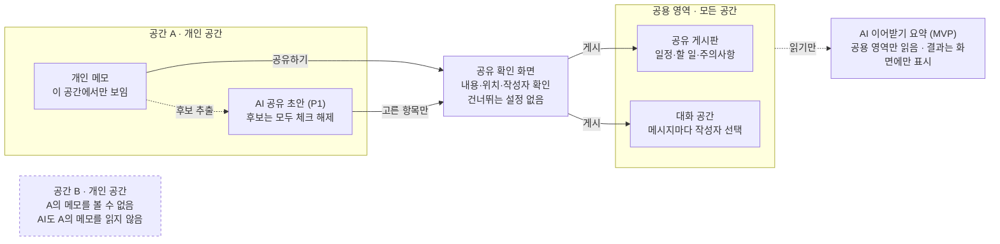

# contiNEW 기능 명세서

2026-11-12 · 초안 v0.2

## 1. 개요

contiNEW MVP는 개인 공간, 공유 게시판, 대화 공간 세 영역과 이를 잇는 '공유하기', 그리고 사용자가 요청할 때 작동하는 AI 이어받기 요약으로 구성합니다. 이 문서는 contiNEW 서비스 기획서를 바탕으로 각 기능의 동작, 규칙, 예외 처리를 정의합니다.

**서비스 정의:** contiNEW는 여러 정체성 상태에 맞춰 개인화된 디지털 공간을 구성하고, 필요한 정보를 선택적으로 공유하며, AI로 이전에 공유된 내용을 쉽게 파악하도록 지원하는 모바일 앱입니다. 하나의 앱 안에 각자 꾸밀 수 있는 개인 공간을 두고, 필요할 때 공용 공간에서 메시지와 생활 정보를 나눕니다. 공간을 몇 개 만들고 어떻게 부를지는 사용자가 정합니다.

**문제 정의(검증 전 가설):** 일부 해리성 정체성 장애(DID) 당사자는 정체성 상태 간 의사소통과 일상 정보의 연속성을 유지하는 데 어려움을 경험할 수 있습니다. contiNEW는 개인적인 기록과 함께 알아야 할 정보를 구분하고, 이전에 공유된 내용을 쉽게 확인할 수 있는 환경을 제안합니다. 실제로 도움이 되는지는 당사자 검증(10장) 전까지 확인되지 않았습니다.

**핵심 가치**

- 독립성: 각 공간에서 개인화된 환경과 기록을 유지합니다. 공간 구분의 의미와 한계는 1.3에 적었습니다.
- 연결성: 사용자가 선택한 정보만 공용 영역에서 공유합니다.
- 연속성: AI가 공유된 기록을 요약해, 마지막으로 확인한 이후의 상황을 파악하기 쉽게 보여 줍니다. 효과를 보장하지 않으며 검증 대상입니다.

**핵심 흐름:** 개인 공간 → 선택적 공유 → 이어받기(요약·확인). 모든 장은 이 흐름을 기준으로 점검합니다.

**제공하지 않는 것:** 이 서비스는 일상 기록과 의사소통을 지원하기 위한 것으로, 진단·치료·상태 판별·전환 감지는 제공하지 않습니다.

**AI 요약 추가에 따른 정리:** 기획서는 MVP에서 'AI 해석'을 제외했습니다. 이 명세는 AI를 '적힌 내용을 짧게 줄이는 도구'로만 정의해 그 원칙을 유지합니다. 감정·상태·관계를 해석하는 기능은 계속 제외합니다. 사용자가 동의한 주기에 요약하는 기능은 P1이며(F-05-7), 이 경우에도 공용 영역만 읽고 해석하지 않습니다.

### 1.1 설계 원칙

모든 기능은 아래 여섯 원칙을 만족해야 하며, 기능 명세와 충돌하면 원칙이 우선합니다.

| ID | 원칙 | 기능에 적용되는 방식 |
| --- | --- | --- |
| 원칙1 | 명시적 공유 | 개인 메모는 사용자가 확인 화면에서 게시하기 전까지 다른 공간에 나타나지 않습니다. AI는 다른 공간의 개인 메모를 어느 단계에서도 읽지 않으며, MVP에서는 개인 메모 자체를 읽지 않습니다(다음 단계에서 사용자가 공간별로 켠 경우만 그 공간의 메모를 읽습니다). |
| 원칙2 | 추측하지 않음 | 앱과 AI는 지금 어떤 상태인지, 누가 썼는지 추정하지 않습니다. 작성자 표기와 확인 표기는 사용자가 직접 고르며, 미리 채워 두지 않습니다. |
| 원칙3 | 해석하지 않음 | AI 요약은 원문에 있는 사실만 줄여 보여줍니다. 감정, 증상, 관계, 위험도를 판단하지 않습니다. |
| 원칙4 | 사람이 최종 결정 | AI 결과는 초안입니다. 사용자가 확인하고 고친 뒤에만 메모·게시판에 저장하거나 게시합니다. 요약함(F-05-7)의 임시 보관은 예외이며 7일 뒤 자동 삭제합니다. |
| 원칙5 | 최소 수집 | 메모·메시지 원문을 이용 분석이나 AI 학습에 쓰지 않습니다. |
| 원칙6 | 지표화 금지 | 기록 빈도, 공간 수, 전환 횟수, 확인 여부를 점수나 그래프로 보여주거나 재촉하지 않습니다. |

우선순위 표기(MVP·P1·P2)와 구분하기 위해 설계 원칙은 '원칙1\~6'으로 부릅니다.

### 1.2 범위

| 구분 | 내용 |
| --- | --- |
| 포함 | 공간 생성·꾸미기, 개인 메모, 공유하기, 공유 게시판, 대화 공간, 중요 정보 확인('확인했어요'), AI 이어받기 요약(요청형), 앱 잠금, 알림 내용 숨김, 휴지통, 내보내기·삭제 |
| 제외 | 상태 자동 감지, AI 해석(감정 분석·상태 추정), 치료자·보호자 계정, 외부 공유, 기록 통계 |
| 플랫폼 | iOS·Android 모바일 앱 (기획서의 '휴대폰 홈 화면처럼 꾸미는' 경험 기준으로 가정) |
| 대상 | DID 관련 경험이 있는 성인. 진단 여부는 가입 조건이 아닙니다. |

### 1.3 공간 구분의 의미와 사용자 안내

공간은 같은 기기, 같은 앱 잠금 안에서 화면과 기록을 나누는 기능입니다. 서로 다른 사람 사이의 접근을 막는 보안 장치가 아닙니다. 앱 잠금(F-06)을 연 사람은 공간 선택 화면에서 어느 공간이든 열 수 있습니다. 공간별 잠금(F-01-8)은 P1이며 도입 여부는 열린 질문 Q2에서 정합니다.

이 사실을 사용자가 오해하지 않도록 다음 안내를 둡니다.

- 첫 공간을 만들기 전 안내 화면(F-01-11)
- 설정 > 공간 관리 상단의 상시 안내
- 메모의 '이 공간에서만 보임' 라벨 옆 설명(F-02-8)

안내 문구(기본안): "공간은 이 앱 안에서 화면과 기록을 나누는 기능이에요. 기기나 앱 잠금을 여는 다른 사람은 모든 공간을 볼 수 있어요. 다른 사람이 보면 안 되는 내용은 앱 잠금을 설정해 주세요."

## 2. 용어 정의

화면 문구는 '교대', '전환', '인격' 같은 임상 용어 대신 아래 중립적인 말을 씁니다.

| 용어 | 정의 |
| --- | --- |
| 앱 | 하나의 기기에 설치된 contiNEW. 그 안의 모든 공간과 공용 영역을 포함합니다. |
| 공간 | 사용자가 만드는 개인 영역. 이름·색상·배경을 가집니다. 정체성 상태와 일대일로 대응할지는 사용자가 정합니다. |
| 개인 메모 | 한 공간 안에서만 보이는 기록. 다른 공간 화면에 나타나지 않는다는 뜻이며, 접근을 막는 보안은 아닙니다(1.3). |
| 공용 영역 | 공유 게시판과 대화 공간을 함께 부르는 말. 모든 공간에서 보입니다. |
| 공유 게시판 | 일정, 할 일, 주의사항, 메모 네 가지 유형의 게시물을 모아 두는 곳. |
| 대화 공간 | 메시지를 남기고 답하는 곳. 메시지마다 작성자 표기를 고릅니다. |
| 작성자 표기 | 게시물·메시지에 붙는 이름. 공간 이름 중 하나 또는 '이름 없이'를 고릅니다. 게시 시점의 글자로 저장해, 나중에 공간 이름이 바뀌어도 원래 표기가 남습니다. |
| 공유하기 | 개인 메모의 내용을 공용 영역에 올리는 명시적 행동. 반드시 공유 확인 화면을 거칩니다. |
| 공유 확인 화면 | 게시 직전에 내용, 올릴 위치, 작성자 표기, 공개 범위를 보여 주는 화면. |
| AI 요약 | 사용자가 요청할 때(P1 단계에서는 사용자가 동의한 주기에), 정해진 범위의 글을 짧게 줄여 보여 주는 기능. 해석·판단을 포함하지 않습니다. |
| 요약 범위 | AI 요약이 한 번에 읽을 수 있는 글의 경계. '공용 영역' 또는 '지금 열린 공간의 개인 메모' 중 하나이며, 둘을 섞지 않습니다. |
| AI 공유 초안 | 개인 메모에서 AI가 골라낸 일정·할 일 후보 중 사용자가 체크한 것만 담은 게시물 초안. |
| 이어받기 요약 | 이 공간에서 공용 영역을 마지막으로 연 뒤 올라온 글을 AI가 짧게 정리해 보여 주는 요약. MVP의 AI 요약은 이것 하나입니다. |
| 확인 요청 | 작성자가 게시물에 켜는 표시. 켜면 '확인했어요' 버튼이 나타납니다. 어떤 정보가 중요한지는 앱이 아니라 작성자가 정합니다. |
| 확인했어요 | 사용자가 직접 누르는 확인 기록. 선택한 공간에서 버튼을 눌렀다는 기록일 뿐, 누가 확인했는지의 증거가 아닙니다. |
| 요약함(P1) | 주기 요약 결과를 기기 안에 임시로 보관하는 곳. 7일 뒤 자동 삭제합니다. |
| 휴지통 | 삭제한 항목을 30일간 보관하는 곳. 개인 메모는 해당 공간의 휴지통에, 공용 영역 항목은 공용 휴지통에 들어갑니다. |

## 3. 사용 시나리오

S1\~S3은 기획서의 기본 흐름이고, S4\~S7은 AI 요약이 더해진 흐름입니다(S7은 P1). 모두 기능이 작동하는 예시이며, 실제 사용 방식이나 효과를 뜻하지 않습니다.

**S1. 개인 메모 작성**

1. 앱을 열면 공간 선택 화면이 나옵니다. 사용자가 공간 하나를 고릅니다.
2. 개인 공간 홈에서 새 메모를 쓰고, 메모는 자동 저장됩니다.
3. 메모에는 '이 공간에서만 보임' 표시가 붙습니다.

**S2. 메모 일부를 공유**

1. 메모에서 내일 약속에 해당하는 문장만 선택하고 '공유하기'를 누릅니다.
2. 공유 확인 화면에서 유형을 '일정'으로 고르고, 날짜·시간을 입력합니다.
3. 작성자 표기와 '앱 안의 모든 공간에서 보입니다' 문구를 확인하고 게시합니다.
4. 원래 메모는 개인 공간에 그대로 남습니다.

**S3. 공유 정보 확인과 질문**

1. 다른 공간을 연 사용자가 홈에서 '공유 게시판 새 글 1개'를 봅니다.
2. 일정을 확인하고, 중요한 정보라면 직접 '확인했어요'를 누릅니다. 장소가 궁금하면 대화 공간에 질문을 남깁니다.
3. 메시지를 보낼 때 작성자 표기를 직접 고릅니다.

**S4. \[AI\] 이어받기: 마지막으로 확인한 이후의 내용 파악**

1. 사용자가 공간을 열자 홈에 '마지막으로 확인한 뒤 새 글 23개 · 요약 보기'가 나옵니다.
2. '요약 보기'를 누르면 AI가 그 이후 공용 영역에 올라온 새 글만 읽고, 다가오는 일정 · 해야 할 일 · 주의사항 · 대화 주요 내용 순으로 정리합니다.
3. 각 항목의 '원문 보기'를 누르면 해당 게시물·메시지로 이동합니다.
4. 확인 요청이 붙은 중요 정보는 원문에서 직접 '확인했어요'를 누를 수 있습니다. 요약만 읽었다고 확인 처리되지는 않습니다.
5. 요약은 화면에만 표시되고 저장·게시되지 않습니다. 개인 메모는 읽지 않습니다.

**S5. \[AI\] 긴 개인 메모에서 공유 초안 만들기**

1. 긴 메모에서 '공유 초안 만들기'를 누릅니다. 이 기능은 해당 공간에서 켜 둔 경우에만 보입니다.
2. AI가 일정·할 일·주의사항 후보를 체크박스 목록으로 보여 줍니다. 모든 체크박스는 비어 있습니다.
3. 사용자가 공유할 항목만 체크하고, 문구를 고칩니다.
4. 공유 확인 화면을 거쳐 게시합니다. 체크하지 않은 내용과 메모 원문은 공간 밖으로 나가지 않습니다.

**S6. \[AI\] 긴 대화 요약**

1. 대화 공간에 메시지가 많이 쌓여 있을 때, 상단의 '요약'을 누르고 기간(오늘 / 최근 3일 / 최근 7일)을 고릅니다.
2. AI가 주요 내용을 5줄 이내로 정리하고, 줄마다 원문 메시지 링크를 붙입니다.
3. 대화 중 일정으로 보이는 내용이 있으면 '게시판에 올리기' 버튼을 보여 주고, 누르면 공유 확인 화면으로 이동합니다.

**S7. \[AI · P1\] 동의한 주기에 요약 받기**

1. 사용자가 설정 > AI 요약에서 주기 요약을 켜고 주기를 고릅니다. 이때 별도 동의 화면을 거칩니다.
2. 앱을 열었을 때 마지막 요약 이후 주기가 지났으면, 공용 영역의 새 글만 요약해 '요약함'에 넣습니다.
3. 사용자는 요약함에서 결과와 원문 링크를 확인합니다. 저장하거나 게시하지 않은 요약은 7일 뒤 지워집니다.
4. 개인 메모는 주기 요약에 포함되지 않습니다.

## 4. 화면 구성

MVP는 9개 화면으로 구성하며, 어느 화면에서든 상단 바에 지금 열린 공간의 이름과 색상을 표시합니다. 엉뚱한 공간에 개인 메모를 쓰는 일을 줄이기 위한 규칙입니다. 하단 탭은 내 공간 · 공유 게시판 · 대화 · 설정 네 개입니다.

| ID | 화면 | 주요 요소 | 관련 기능 |
| --- | --- | --- | --- |
| SCR-01 | 잠금 화면 | PIN·생체인증. 앱 내용 미리보기 없음 | F-06 |
| SCR-02 | 공간 선택 | 공간 카드(이름·색상), 새 공간 만들기, 공간 구분 안내(1.3), 안내 문구 "어느 공간을 열까요?" | F-01 |
| SCR-03 | 개인 공간 홈 | 꾸민 배경, 홈 구성 위젯(메모·일정·바로가기), 메모 목록, 공용 영역 새 글 수와 '요약 보기', 다가오는 일정 2개 | F-01, F-02, F-05 |
| SCR-04 | 메모 작성·보기 | 본문, '이 공간에서만 보임' 라벨, 공유하기, 공유 초안 만들기(AI), 요약(AI) | F-02, F-03, F-05 |
| SCR-05 | 공유 확인 | 올릴 위치, 유형, 본문 편집, 작성자 표기, 공개 범위 문구, 게시·취소 | F-03 |
| SCR-06 | 공유 게시판 | 유형 필터, 상단 고정 주의사항, 일정 날짜순, 지난 항목, 확인 요청 표시와 '확인했어요', 요약 보기 | F-03, F-04, F-05 |
| SCR-07 | 대화 공간 | 메시지 목록, 작성자 선택, 답장, 검색, 게시판에 올리기, 요약 | F-04, F-05 |
| SCR-08 | AI 요약 결과 | 고정 4개 묶음, 항목별 원문 보기, 안내 문구, 닫기 | F-05 |
| SCR-09 | 설정 | 공간 관리, 앱 잠금, 알림, AI 요약 설정·동의(주기 요약은 P1), 휴지통, 내보내기·삭제, 도움 받을 곳 | F-01, F-05\~F-10 |



개인 메모는 공유 확인 화면을 거쳐야만 공용 영역에 들어갑니다. AI는 한 번에 한 범위만 읽고, 결과를 스스로 게시하지 않습니다.

## 5. 기능 상세 명세: 공간·메모·공유·대화

우선순위는 MVP(최초 시제품), P1(검증 후 다음 단계), P2(추후 검토) 세 단계로 표시합니다. 설계 원칙은 '원칙1\~6'으로 구분합니다(1.1). AI 요약(F-05)은 6장, 보안·개인정보 기능(F-06\~F-10)은 7장에 있습니다.

### F-01 공간 관리

사용자가 필요한 만큼 공간을 만들고, 공간마다 익숙한 모습으로 꾸밀 수 있게 합니다.

| ID | 요구사항 | 우선순위 |
| --- | --- | --- |
| F-01-1 | 공간 생성: 이름(필수, 1\~20자, 중복 불가), 색상(필수, 12색 팔레트), 배경(선택: 기본·단색·기기 사진), 아이콘(선택). | MVP |
| F-01-2 | 첫 실행 때 공간 1개만 만들어도 바로 시작합니다. 공간 추가를 권하는 문구·알림은 넣지 않습니다(원칙6). | MVP |
| F-01-3 | 공간 꾸미기: 배경, 테마 색상, 글자 크기를 공간마다 따로 저장합니다. | MVP |
| F-01-4 | 기본 홈 구성 변경: 메모·일정·바로가기 위젯을 켜고 끄고 순서를 바꿉니다. 공간마다 따로 저장합니다. | MVP |
| F-01-5 | 공간 수정: 이름·색상·배경을 바꿉니다. 이미 게시한 글의 작성자 표기는 바뀌지 않습니다. | MVP |
| F-01-6 | 공간 숨기기: 공간 선택 화면에서 감추되 내용은 유지합니다. 설정에서 다시 보이게 합니다. | MVP |
| F-01-7 | 공간 삭제: 개인 메모가 함께 삭제된다고 알리고, 앱 잠금 재인증 후 실행합니다. 삭제한 공간은 30일간 복구할 수 있습니다. | MVP |
| F-01-8 | 공간별 잠금(선택): 공간마다 별도 PIN을 겁니다. 잊었을 때는 앱 잠금 인증으로 초기화합니다. | P1 (열린 질문 Q2) |
| F-01-9 | 공간 개수는 기술적 상한(예: 50개)만 둡니다. | MVP |
| F-01-10 | 홈 자유 배치: 위젯을 원하는 위치로 옮기고 크기를 바꿉니다. | P1 |
| F-01-11 | 공간 구분 안내: 첫 공간을 만들기 전과 설정 > 공간 관리 상단에 1.3의 안내 문구를 보여 줍니다. | MVP |

예외 처리

- 공간이 하나뿐이면 그 공간은 숨기거나 삭제할 수 없습니다.
- 앱을 열 때 마지막으로 연 공간을 자동으로 열지 않고 공간 선택 화면을 보여줍니다(원칙2). 공간이 하나뿐일 때만 바로 엽니다.
- 삭제한 공간 이름으로 작성된 공용 글은 그대로 남습니다.

### F-02 개인 메모

한 공간 안에서만 보이는 기록을 작성하고 관리합니다.

| ID | 요구사항 | 우선순위 |
| --- | --- | --- |
| F-02-1 | 텍스트 메모 작성. 입력 중 2초마다 자동 저장합니다. | MVP |
| F-02-2 | 메모마다 '이 공간에서만 보임' 라벨을 표시합니다. | MVP |
| F-02-3 | 목록: 최신순, 상단 고정, 공간 안 검색. | MVP |
| F-02-4 | 수정·삭제. 삭제하면 이 공간의 휴지통으로 이동합니다(30일). | MVP |
| F-02-5 | 메모에서 공유한 적이 있으면 '공유함' 표시와 해당 게시물 링크를 남깁니다. | MVP |
| F-02-6 | 체크리스트, 사진 첨부. | P1 |
| F-02-7 | 음성 메모. | P2 |
| F-02-8 | '이 공간에서만 보임' 라벨 옆 '?'를 누르면 1.3의 안내 문구를 보여 줍니다. 공간 구분이 접근 차단이 아님을 알리기 위함입니다. | MVP |

예외 처리

- 작성 중 공간을 바꾸면 초안은 원래 공간에 임시 저장되고, 다른 공간에서는 보이지 않습니다.
- 메모 내용은 알림, 위젯, 최근 앱 화면에 표시하지 않습니다.
- 메모와 공유한 게시물은 복사본 관계입니다. 한쪽을 고치거나 지워도 다른 쪽은 바뀌지 않습니다.

### F-03 공유하기 · 공유 게시판

개인 메모의 내용을 명시적으로 공용 영역에 올리고, 함께 알아야 할 정보를 한곳에서 봅니다.

| ID | 요구사항 | 우선순위 |
| --- | --- | --- |
| F-03-1 | 공유 진입 경로 3가지: 메모 문장 선택 후 공유, 메모 전체 공유, 게시판에서 직접 작성. | MVP |
| F-03-2 | 메모에서 공유하면 내용을 복사해 초안을 만듭니다. 원본 메모는 개인 공간에 그대로 남습니다. | MVP |
| F-03-3 | 공유 확인 화면(SCR-05): 올릴 위치, 유형, 본문, 작성자 표기, "앱 안의 모든 공간에서 보입니다" 문구를 보여줍니다. 이 화면을 건너뛰는 설정은 두지 않습니다. 작성자 표기는 기본적으로 비어 있으며, 사용자가 직접 고른 뒤에 게시할 수 있습니다(원칙2). | MVP |
| F-03-4 | 게시물 유형 4가지: 일정(날짜·시간 필수, 장소 선택), 할 일(마감일 선택), 주의사항, 메모. | MVP |
| F-03-5 | 정렬: 주의사항(상단 고정) → 다가오는 일정(날짜순) → 미완료 할 일 → 메모(최신순). 지난 일정과 완료한 할 일은 '지난 항목'으로 접습니다. | MVP |
| F-03-6 | 할 일 완료: 체크하면 완료 시각을 기록합니다. 완료한 사람 표기는 선택입니다. | MVP |
| F-03-7 | 수정: 어느 공간에서든 고칠 수 있고, '수정됨' 표시와 이전 버전 보기를 제공합니다. | MVP |
| F-03-8 | 삭제: 공용 휴지통으로 이동하며, 30일 안에 어느 공간에서든 복구합니다. | MVP |
| F-03-9 | 새 글 표시: 공간마다 공용 영역을 마지막으로 연 시각을 저장하고, 그 뒤 새 글 수를 배지로 보여줍니다. | MVP |
| F-03-10 | 일정·할 일 알림: 기본값은 일정 1시간 전, 마감 당일 오전 9시이며 바꿀 수 있습니다. 문구는 F-07 규칙을 따릅니다. | MVP |
| F-03-11 | 확인 요청: 공유 확인 화면에서 일정·할 일·주의사항 게시물에 '확인 요청'을 켤 수 있습니다(기본 꺼짐). 켠 게시물에는 '확인했어요' 버튼이 나타납니다(F-04-7). 어떤 정보가 중요한지는 앱이 판단하지 않고 작성자가 정합니다(원칙2). | MVP |

예외 처리

- 공유 확인 화면에서 취소하면 초안을 버리고, 원본 메모에는 변화가 없습니다.
- 게시 후 '공유 취소'는 게시물을 공용 휴지통으로 옮깁니다. "이미 다른 공간에서 봤을 수 있어요" 안내를 함께 보여줍니다.
- 일정 유형에 날짜가 없으면 게시 버튼을 끄고 '할 일' 또는 '메모' 유형을 제안합니다.

### F-04 대화 공간

공간들 사이에서 메시지를 남기고, 이전 대화를 확인합니다.

| ID | 요구사항 | 우선순위 |
| --- | --- | --- |
| F-04-1 | 공용 대화방 1개. 주제별 대화방은 P1입니다. | MVP |
| F-04-2 | 메시지마다 작성자 표기를 고릅니다. 선택지는 공간 이름 목록과 '이름 없이'입니다. 작성자 칸은 기본적으로 비어 있고, 사용자가 직접 고른 뒤에 보낼 수 있습니다. 지금 열린 공간 이름이나 직전에 고른 표기를 미리 채우지 않습니다(원칙2, 열린 질문 Q1 결정). | MVP |
| F-04-3 | 답장(인용), 키워드 검색. | MVP |
| F-04-4 | 메시지 메뉴 '게시판에 올리기': 메시지 내용으로 게시물 초안을 만들고 공유 확인 화면으로 이동합니다. 중요한 약속이 대화에 묻히지 않게 하는 기능입니다. | MVP |
| F-04-5 | 수정은 '수정됨'과 이전 버전 보기, 삭제는 '삭제된 메시지' 자리 표시와 공용 휴지통으로 처리합니다. | MVP |
| F-04-6 | 특정 공간 지정(@공간 이름): 지정한 공간의 홈에 표시합니다. | P1 |
| F-04-7 | '확인했어요': 확인 요청이 켜진 게시물(F-03-11)과 대화 메시지에서 사용자가 직접 누를 때만 기록합니다. 누른 뒤에도 취소할 수 있습니다. | MVP |
| F-04-8 | 사진 첨부. | P1 |
| F-04-9 | 확인 기록: 확인 시각과, 사용자가 고른 표기(공간 이름 또는 '이름 없이', 기본은 '이름 없이')만 저장하고 공간 id는 저장하지 않습니다(8장). 이 기록은 '버튼을 누른 기록'이며 누가 확인했는지의 증거가 아닙니다. | MVP |
| F-04-10 | 확인 표시: 게시물·메시지에 '확인 N건 · 마지막 확인 시각'을 보여 줍니다. 확인 기록이 없는 확인 요청 게시물에는 '아직 확인 기록 없음'만 표시하고, 재촉하는 문구나 알림은 쓰지 않습니다(원칙6). | MVP |

예외 처리

- 자동 읽음 표시는 만들지 않습니다. 열린 공간만으로 '누가 읽었다'고 표시하면 앱이 상태를 추정하는 것이 되기 때문입니다(원칙2). '확인했어요'는 사용자가 직접 누른 기록만 남깁니다.
- 대화 공간은 개인 메모를 인용하거나 첨부할 수 없습니다. 개인 메모는 공유하기(F-03)로만 옮길 수 있습니다.

## 6. AI 요약 기능 명세 (F-05)

AI 요약은 한 번에 한 범위 안의 글만 읽고, 원문에 있는 사실을 출처와 함께 줄여 보여줍니다. 기본값은 꺼짐입니다. MVP는 사용자가 버튼을 눌렀을 때만 요약하는 요청형이며, 이미 공유된 글만 다루는 '이어받기 요약'(F-05-2)을 넣습니다. 사용자가 동의한 주기에 요약하는 기능(F-05-7)과 개인 메모를 읽는 기능(F-05-3, F-05-4)은 검증 후 P1로 둡니다. 어느 단계에서도 다른 공간의 개인 메모는 읽지 않습니다.

### 6.1 하는 일과 하지 않는 일

**하는 일**

- 원문에 적힌 일정·할 일·주의사항·대화 내용을 짧게 정리합니다.
- 항목마다 원문 링크를 붙입니다.
- '내일', '다음 주' 같은 표현을 원글 작성일 기준 날짜로 바꿔 원문 표현과 함께 보여줍니다. 작성 시점과 읽는 시점이 다를 때 생기는 혼동을 줄이기 위한 규칙입니다.
- 사용자가 고른 항목으로 공유 초안을 만듭니다(원칙1, 다음 단계).

**하지 않는 일**

- 지금 누구인지, 글을 누가 썼을지 추정하기
- 감정·기분·증상·위험도 판단, 공간 사이의 관계나 갈등 해석
- 조언이나 치료적 제안
- 결과를 자동으로 저장하거나 게시하기
- 다른 공간의 개인 메모 읽기, 공용 영역과 개인 메모를 한 요청에 섞기
- 사용자 데이터를 모델 학습에 쓰기

### 6.2 요구사항

**F-05-1 설정과 동의**

| ID | 요구사항 | 우선순위 |
| --- | --- | --- |
| F-05-1a | AI 요약은 기본 꺼짐이며 설정 > AI 요약에서 켭니다. | MVP |
| F-05-1b | 켤 때 동의 화면에서 어떤 글이 어디로 가는지, 처리 후 즉시 삭제, 학습 미사용, 언제든 끌 수 있음을 보여줍니다. 서버 처리 방식이면 민감정보 처리에 대한 별도 동의를 받습니다. | MVP |
| F-05-1c | 공용 영역 요약은 앱 전체 설정입니다. 개인 메모 요약은 공간마다 따로 켜며, 그 공간 안에서만 바꿀 수 있습니다. | MVP / P1 |
| F-05-1d | AI 요약이 켜져 있으면 공용 영역 상단에 'AI 요약 켜짐' 표시를 항상 보여줍니다. 다른 공간에서도 자기 글이 요약에 쓰일 수 있음을 알 수 있게 하기 위함입니다. | MVP |
| F-05-1e | 끄면 기기에 남은 요약 결과를 즉시 지웁니다. | MVP |

**F-05-2 이어받기 요약 (공용 영역)**

| ID | 요구사항 | 우선순위 |
| --- | --- | --- |
| F-05-2a | 진입: 공간 홈의 '마지막으로 확인한 뒤 새 글 N개 · 요약 보기', 공유 게시판·대화 공간 상단의 '요약'. | MVP |
| F-05-2b | 기간: 이 공간에서 마지막으로 연 뒤(기본) / 오늘 / 최근 3일 / 최근 7일. 대상: 공유 게시판, 대화 공간, 둘 다(기본). '마지막으로 확인한 뒤'는 이 공간에서 공용 영역 화면을 마지막으로 연 시각(F-03-9) 기준이며, 읽었다는 표시가 아닙니다(원칙2). | MVP |
| F-05-2c | 출력은 4개 묶음으로 고정합니다: 다가오는 일정 → 해야 할 일 → 주의사항 → 대화 주요 내용. 내용이 없는 묶음은 숨깁니다. | MVP |
| F-05-2d | 분량 상한: 묶음당 5개 항목, 대화 주요 내용 5줄, 항목당 60자. 넘치면 '원문에서 더 보기'를 둡니다. | MVP |
| F-05-2e | 모든 항목에 원문 링크를 붙입니다. 출처를 연결할 수 없는 항목은 표시하지 않습니다. | MVP |
| F-05-2f | 작성자 표기는 원문에 적힌 그대로만 씁니다. 원문이 '이름 없이'이면 요약에도 이름을 붙이지 않습니다. | MVP |
| F-05-2g | 날짜는 계산한 날짜와 원문 표현을 함께 보여줍니다. 예: "11/13(금) 오후 2시 · 원문: '내일 2시'". 계산이 불확실하면 원문 표현만 두고 '날짜 확인 필요'를 붙입니다. | MVP |
| F-05-2h | 결과 화면 하단 고정 문구: "AI가 만든 요약이라 빠지거나 틀린 내용이 있을 수 있어요. 중요한 일정은 원문을 확인해 주세요." | MVP |
| F-05-2i | 결과는 화면에만 표시하고 저장·게시하지 않습니다. 같은 범위는 기기 캐시를 다시 쓰고, 원문이 바뀌면 캐시를 버립니다. 주기 요약의 요약함(F-05-7)만 예외입니다. | MVP |
| F-05-2j | 새 글이 3개 이하이면 요약하지 않고 원문 목록을 바로 보여줍니다. | MVP |
| F-05-2k | 확인 요청이 붙은 항목에는 원문으로 가서 '확인했어요'를 누르도록 안내만 하고, 요약 화면에서 대신 확인 처리하지 않습니다. | MVP |

**F-05-3 개인 메모 요약**

| ID | 요구사항 | 우선순위 |
| --- | --- | --- |
| F-05-3a | 1,000자 이상인 메모 또는 여러 메모를 골라 '요약'합니다. 이 공간에서 켜 둔 경우에만 버튼이 보입니다. | P1 |
| F-05-3b | 결과는 이 공간 안에서만 보입니다. '요약 메모로 저장'을 누르면 이 공간에 새 메모로 저장합니다. | P1 |
| F-05-3c | 결과 화면에는 '공유하기' 버튼을 두지 않습니다. 공유는 F-05-4 또는 F-03을 거칩니다. | P1 |

**F-05-4 공유 초안 만들기**

| ID | 요구사항 | 우선순위 |
| --- | --- | --- |
| F-05-4a | 메모의 '공유 초안 만들기'를 누르면 AI가 일정·할 일·주의사항 후보를 최대 10개 뽑아 체크박스 목록으로 보여줍니다. | P1 |
| F-05-4b | 모든 체크박스는 해제 상태로 시작하며, '모두 선택'은 두지 않습니다. 무엇을 공유할지는 AI가 아니라 사용자가 정합니다(원칙1). | P1 |
| F-05-4c | 후보마다 근거가 된 메모 문장을 함께 보여줍니다. | P1 |
| F-05-4d | 고른 항목만 초안에 들어갑니다. 사용자가 편집한 뒤 공유 확인 화면(F-03-3)을 거쳐 게시합니다. | P1 |
| F-05-4e | 화면을 닫으면 후보 목록과 고르지 않은 항목을 지웁니다. | P1 |

**F-05-5 출력 안전 규칙**

| ID | 요구사항 | 우선순위 |
| --- | --- | --- |
| F-05-5a | 원문에 없는 날짜·장소·사람·숫자를 추가하지 않습니다. 앱이 항목을 원문과 대조해, 원문에 없는 날짜·숫자가 있으면 그 항목을 뺍니다. | MVP |
| F-05-5b | 금지 표현: 진단명, 증상 판단, 상태 추정("\~한 상태로 보입니다"), 감정 평가("불안해 보입니다"), 조언. 걸리면 그 줄을 원문 링크로 바꿉니다. | MVP |
| F-05-5c | 확신 있게 줄일 수 없는 글은 순화하거나 축약하지 않고 '원문 확인 필요'로 링크만 남깁니다. AI는 위험도를 판단하거나 경고를 띄우지 않습니다(열린 질문 Q5). | MVP |
| F-05-5d | 응답은 6.3의 JSON 구조로만 받고, 화면은 앱이 그립니다. 자유 서술형 응답은 쓰지 않습니다. | MVP |

**F-05-6 처리 방식과 개인정보**

| ID | 요구사항 | 우선순위 |
| --- | --- | --- |
| F-05-6a | 한 요청에는 한 요약 범위의 글만 보냅니다. 공용 영역 요청을 만드는 코드는 공용 데이터만 읽도록 분리합니다. | MVP |
| F-05-6b | 서버로 보낼 때 작성자 표기를 '작성자1, 작성자2'로 바꿔 보내고, 응답을 받은 뒤 기기에서 원래 이름으로 되돌립니다. | MVP |
| F-05-6c | 외부 AI API는 입력 보관·학습 미사용 조건을 계약·설정으로 확인한 곳만 씁니다. 서버 로그에 원문과 요약문을 남기지 않습니다. | MVP |
| F-05-6d | 기기 안 모델로 충분한 품질이 나오면 기기 안 처리를 우선합니다. 처리 위치는 기술 검토 후 확정합니다(열린 질문 Q3). | MVP 결정 필요 |
| F-05-6e | 이용 분석은 요약 요청 횟수와 실패율만 모읍니다. 원문·요약문·범위 내용은 수집하지 않습니다. | MVP |
| F-05-6f | 서버 처리 시 하루 요청 상한(예: 20회)을 둡니다. | MVP |

**F-05-7 주기 요약 (P1)**

| ID | 요구사항 | 우선순위 |
| --- | --- | --- |
| F-05-7a | 기본 꺼짐. 설정 > AI 요약 > 주기 요약에서 켜며, 켤 때 별도 동의 화면에서 주기, 읽는 범위(공용 영역만), 처리 위치, 언제든 끌 수 있음을 알립니다. | P1 |
| F-05-7b | 주기는 사용자가 고릅니다: 하루 1회 / 2일에 1회 / 주 1회. 기본 선택값은 두지 않습니다. | P1 |
| F-05-7c | 범위는 공용 영역의 새 글만입니다. 개인 메모는 어떤 주기 요약에도 포함하지 않습니다(원칙1). | P1 |
| F-05-7d | 생성 시점(기본 설계안): 앱을 열었을 때 마지막 요약 이후 주기가 지났으면 요약합니다. 앱이 꺼져 있는 동안의 예약 생성은 열린 질문 Q9에서 정합니다. | P1 |
| F-05-7e | 결과는 요약함에서만 확인합니다. 요약함은 최근 3건을 기기 안에 임시 보관하고 7일 뒤 자동 삭제합니다. 사용자가 '메모로 저장'이나 '게시판에 올리기'(공유 확인 화면 경유)를 누르지 않으면 어디에도 저장·게시되지 않습니다(원칙4). | P1 |
| F-05-7f | 요약 완료 알림 문구는 "contiNEW · 확인할 요약이 있어요"로 고정하며 요약 내용은 알림에 나오지 않습니다(F-07-4). | P1 |
| F-05-7g | 출력 형식·안전 규칙(F-05-5)과 처리 방식(F-05-6)을 그대로 따릅니다. 주기 요약은 하루 최대 1회이며 하루 요청 상한(F-05-6f)에 포함합니다. | P1 |
| F-05-7h | 끄면 요약함을 즉시 지웁니다. 요약을 몇 번 받았는지, 확인했는지는 점수나 통계로 보여주지 않습니다(원칙6). | P1 |

**실패·예외 처리**

- 네트워크가 없으면 "지금은 요약할 수 없어요"와 함께 원문 목록 보기 버튼을 보여줍니다.
- 범위의 글이 300개를 넘으면 기간을 줄이도록 안내합니다.
- 3초가 넘으면 진행 표시와 취소 버튼을 보여주고, 20초가 넘으면 실패로 처리합니다.
- 요약 중 원문이 수정·삭제되면 결과를 버리고 다시 요청할지 묻습니다.
- AI 요약이 꺼져 있으면 요약 버튼을 아예 보여주지 않습니다.

### 6.3 요약 응답 구조

AI는 아래 구조의 JSON만 돌려주고, 앱은 `source_ids`가 비었거나 존재하지 않는 항목을 버립니다. `date_confidence`가 `low`이면 '날짜 확인 필요'를 붙입니다.

```json
{
  "range": {"scope": "shared", "from": "2026-11-09T21:00:00+09:00", "to": "2026-11-12T15:00:00+09:00"},
  "events": [
    {"title": "치과 진료", "date": "2026-11-13", "time": "14:00", "original_phrase": "내일 2시", "date_confidence": "high", "source_ids": ["post_812"]}
  ],
  "todos": [
    {"title": "택배 반품 접수", "due": null, "source_ids": ["msg_3301"]}
  ],
  "cautions": [
    {"text": "회사 출입증은 가방 안쪽 주머니에 있음", "source_ids": ["post_809"]}
  ],
  "conversation": [
    {"text": "주말 일정은 아직 정하지 않음", "author_labels": ["작성자2"], "source_ids": ["msg_3290", "msg_3294"]}
  ],
  "needs_original": ["msg_3297"]
}
```

## 7. 보안·개인정보 기능과 비기능 요구사항

기획서가 꼽은 위험(기록 노출, 공유 실수, 기록 손실)을 기능 단위로 막는 장입니다. 저장 구조는 기기 안에만 보관하는 '로컬 우선'을 권장하며, 서버는 AI 요약 요청을 중계할 때만 씁니다.

### F-06 앱 잠금과 화면 보호

| ID | 요구사항 | 우선순위 |
| --- | --- | --- |
| F-06-1 | 앱 잠금: 6자리 PIN과 생체인증(선택). 첫 실행 때 설정을 권하되 건너뛸 수 있습니다. | MVP |
| F-06-2 | 자동 잠금: 앱을 벗어난 뒤 즉시 / 1분(기본) / 5분. | MVP |
| F-06-3 | 최근 앱 화면 가리기: 앱 전환 화면에서 내용을 가립니다(iOS 가림 화면, Android FLAG\_SECURE). | MVP |
| F-06-4 | PIN을 잊으면 생체인증으로 재설정합니다. 둘 다 안 되면 초기화만 가능하며(백업 복원은 P1, F-09-3), 이 사실을 PIN 설정 때 미리 알립니다. | MVP |

### F-07 알림

| ID | 요구사항 | 우선순위 |
| --- | --- | --- |
| F-07-1 | 알림 문구 기본값은 내용 숨김입니다: "contiNEW · 확인할 일정이 있어요". 게시물 제목 표시는 설정에서 켭니다. | MVP |
| F-07-2 | 개인 메모 내용은 어떤 설정에서도 알림에 나오지 않습니다. | MVP |
| F-07-3 | 알림을 누르면 잠금 해제 → 공간 선택 → 해당 공용 항목 순서로 엽니다. | MVP |
| F-07-4 | 요약 완료 알림(F-05-7): 문구는 "contiNEW · 확인할 요약이 있어요"로 고정하고 요약 내용은 표시하지 않습니다. | P1 |

### F-08 휴지통과 수정 이력

| ID | 요구사항 | 우선순위 |
| --- | --- | --- |
| F-08-1 | 삭제한 항목은 30일간 휴지통에 보관한 뒤 자동으로 영구 삭제합니다. | MVP |
| F-08-2 | 개인 메모 휴지통은 해당 공간에서만, 공용 휴지통은 모든 공간에서 보입니다. | MVP |
| F-08-3 | 휴지통 비우기(즉시 영구 삭제)는 앱 잠금 재인증 후 실행합니다. | MVP |
| F-08-4 | 공용 항목을 고치면 직전 버전 1개를 보관하고 '이전 버전 보기'로 확인합니다. | MVP |
| F-08-5 | 수정 이력 확대: 항목당 최근 20개 버전까지 보관하고 버전을 비교해 봅니다. | P1 |

### F-09 내보내기와 삭제

| ID | 요구사항 | 우선순위 |
| --- | --- | --- |
| F-09-1 | 열람용 내보내기(TXT·PDF): 공용 영역은 어느 공간에서나, 개인 메모는 그 공간에서만 내보냅니다. | MVP |
| F-09-2 | 기기 변경용 전체 백업: 모든 공간을 담은 암호화 파일 1개입니다. 앱 잠금 재인증과 백업 비밀번호가 필요하고, contiNEW에서만 열립니다. | P1 (보안 검토 후 확정) |
| F-09-3 | 백업 파일 복원. | P1 |
| F-09-4 | 전체 데이터 삭제: 재인증과 "모두 삭제" 직접 입력 후 실행하고, 복구할 수 없다고 알립니다. | MVP |

MVP에서는 기기를 바꾸거나 잃어버리면 기록을 옮길 수 없습니다. 이 사실을 설정 > 내보내기·삭제에서 알리고, 열람용 내보내기(F-09-1)를 먼저 쓰도록 안내합니다.

### F-10 도움 받을 곳

| ID | 요구사항 | 우선순위 |
| --- | --- | --- |
| F-10-1 | 설정과 메뉴에 '도움 받을 곳' 안내 페이지를 둡니다(예: 자살예방상담전화 109, 정신건강위기상담전화 1577-0199). 번호는 출시 전 최신 여부를 확인합니다. | MVP |
| F-10-2 | 이 페이지는 고정 안내이며, 앱이 기록 내용을 보고 띄우지 않습니다. 진료나 위기 지원을 대신한다는 문구는 쓰지 않습니다. | MVP |

### 7.1 비기능 요구사항

| 구분 | 요구사항 |
| --- | --- |
| 저장 구조 | 로컬 우선. 모든 기록을 기기 안 암호화 DB에 저장하고, MVP에는 회원가입과 서버 저장을 두지 않습니다(권장안, 보안 검토 후 확정). |
| 암호화 | 기기 DB는 OS 키 저장소(iOS Keychain, Android Keystore)의 키로 암호화합니다. 전송은 TLS 1.2 이상입니다. |
| 오프라인 | AI 요약을 뺀 모든 기능은 네트워크 없이 동작합니다. |
| 성능 | 앱 실행부터 공간 선택 화면까지 2초 이내, 메모 저장 0.5초 이내, AI 요약은 요청의 90%를 10초 이내. |
| 접근성 | 글자 크기 4단계, 고대비 테마, 스크린리더 라벨. 공간은 색상만으로 구분하지 않고 이름·아이콘을 함께 표시합니다. |
| 표현 | 쉬운 문장을 쓰고, 임상 용어와 사용자를 평가하거나 재촉하는 문구를 쓰지 않습니다. |
| 법·규제 | 건강 관련 기록은 개인정보 보호법상 민감정보에 해당할 수 있어 별도 동의와 최소 수집을 적용합니다. 의료기기로 오인될 효능 표현은 쓰지 않으며, 출시 전 법률 검토가 필요합니다. |
| 이용 분석 | 기능 사용 횟수만 수집하고 원문·공간 이름은 수집하지 않습니다. 사용자가 끌 수 있습니다. |

## 8. 데이터 모델 개요

모든 데이터는 기기 안에 저장하고, 개인 메모와 공용 항목을 별도 테이블로 나눕니다. 공유하기는 메모를 옮기는 것이 아니라 공용 테이블에 새 행을 만드는 동작입니다.

| 엔티티 | 주요 필드 | 비고 |
| --- | --- | --- |
| Space | id, name, color, background, icon, sort\_order, hidden, deleted\_at, ai\_memo\_enabled, pin\_hash(P1) | 공간 |
| Memo | id, space\_id, body, pinned, shared\_post\_ids, created\_at, updated\_at, deleted\_at | 개인 메모. space\_id로만 조회 |
| BoardPost | id, type(event·todo·caution·note), title, body, event\_at, place, due\_at, done\_at, done\_by\_label, author\_label, origin(manual·memo·message·ai\_draft), pinned, confirm\_requested, created\_at, updated\_at, deleted\_at | 공유 게시판 |
| Message | id, body, author\_label, reply\_to\_id, created\_at, edited\_at, deleted\_at | 대화 공간 |
| Confirmation | id, target\_type(post·message), target\_id, confirmed\_at, confirm\_label(선택) | '확인했어요' 기록. 공간 id를 저장하지 않음 |
| Revision | id, target\_type, target\_id, body\_snapshot, created\_at | 공용 항목 수정 이력. MVP는 항목당 직전 1개, P1에서 20개 |
| SpaceViewState | space\_id, area(board·chat), last\_viewed\_at | 새 글 수, 요약 기본 기간 계산 |
| SummaryCache | id, scope(shared·memo), space\_id(memo일 때만), range\_from, range\_to, result\_json, source\_ids, created\_at | 원문이 바뀌거나 AI를 끄면 삭제 |
| SummaryInbox(P1) | id, result\_json, source\_ids, range\_from, range\_to, created\_at, expires\_at | 주기 요약 임시 보관(요약함). 7일 뒤 삭제, 끄면 즉시 삭제 |
| Settings | app\_lock, auto\_lock, notify\_preview, ai\_shared\_enabled, ai\_mode(device·server), ai\_consent\_at, summary\_schedule(P1), analytics\_enabled | 앱 전체 설정 |

설계 규칙

- 공용 항목(BoardPost, Message, Confirmation)은 작성하거나 확인한 공간의 id를 저장하지 않고 표기 글자(author\_label, confirm\_label)만 저장합니다. '이름 없이'로 쓴 글이 어느 공간에서 나왔는지 남지 않게 하기 위함입니다.
- Memo를 읽는 함수는 지금 열린 space\_id를 반드시 받습니다. 여러 공간의 메모를 한 번에 읽는 함수는 전체 백업(F-09-2)에만 둡니다.
- AI 요약 요청을 만드는 코드는 scope가 shared이면 BoardPost·Message만, memo이면 해당 space\_id의 Memo만 읽습니다.
- 주기 요약(F-05-7)도 scope가 shared인 요청만 만들 수 있으며, 결과는 SummaryInbox에만 둡니다.

## 9. 릴리스 범위

MVP를 키우지 않기 위해 v0.2에서 올린 것과 내린 것을 함께 정했습니다.

- **올림(P1 → MVP):** 기본 홈 구성 변경(F-01-4), 중요 정보 확인(F-03-11, F-04-7·9·10), 공간 구분 안내(F-01-11, F-02-8)
- **내림(MVP → P1):** 수정 이력 20개 확대(F-08-5, MVP에는 직전 1개만 남김), 전체 백업·복원(F-09-2·3)
- **새로 정함:** MVP의 AI 요약은 요청형 이어받기 요약 하나이며, 주기 요약은 P1(F-05-7)

| 단계 | 기능 | 다음 단계로 넘어가는 조건 |
| --- | --- | --- |
| MVP | 공간 생성·기본 꾸미기·기본 홈 구성(F-01-1\~9·11), 텍스트 메모·공간 구분 안내(F-02-1\~5·8), 공유하기·공유 게시판·확인 요청(F-03), 공용 대화방·'확인했어요'(F-04-1\~5·7·9·10), 이어받기 요약과 안전 규칙(F-05-1·2·5·6), 잠금·알림·휴지통·직전 버전·내보내기·도움 안내(F-06\~F-10의 MVP 항목) | 시험 사용자가 공개 범위와 '확인했어요'의 의미를 정확히 이해하고, 요약 오류로 인한 약속 놓침이 없을 것 |
| P1 | 홈 자유 배치(F-01-10), 공간별 잠금, 체크리스트·사진, 주제별 대화방, @공간 지정, 주기 요약(F-05-7), 개인 메모 요약(F-05-3), 공유 초안 만들기(F-05-4), 수정 이력 20개(F-08-5), 전체 백업·복원(F-09-2·3) | 개인 메모·주기 요약에 대한 당사자 수용도 확인, AI 처리 위치와 주기 요약 실행 방식(Q3·Q9) 확정, 백업 보안 검토 |
| P2 | 음성 메모, 기기 간 동기화, 기기 홈 화면 위젯 | 보안 검토와 수요 확인 |
| 제외 | 상태 자동 감지, 감정 분석·상태 추정, 치료자·보호자 연동, 외부 공유, 기록 통계 | 설계 원칙(원칙2·3·6)에 따라 제외 |

## 10. 검증 계획

기획서의 4단계 검증에 AI 요약 검증 두 가지(가상 데이터 정확도 평가, '며칠 만에 열었을 때' 과제)를 더합니다. 판단 기준은 사용량이 아니라 공개 범위 이해, 정보 찾기, 불편하거나 불안한 순간입니다.

1. 당사자 인터뷰: 개인 기록과 공용 정보의 구분이 실제 필요인지, AI가 공용 글을 요약하거나 개인 메모를 읽는 것, 동의한 주기에 요약을 받는 것(P1)을 어떻게 느끼는지 확인합니다.
2. AI 정확도 내부 평가: 사람이 참여하기 전에, 가상 공용 글 묶음 50세트(상대 날짜, '이름 없이' 글, 민감한 표현 포함)로 요약 품질을 측정합니다.
3. 화면 시제품 과제: 개인 메모 작성 → 선택적 공유 → 다른 공간에서 확인 → '확인했어요' 누르기를 수행하게 합니다.
4. '며칠 만에 열었을 때' 과제: 요약 있음·없음 조건에서 다가오는 일정을 찾게 하고 정확도와 걸린 시간을 비교합니다.
5. 기존 서비스 비교: Simply Plural, Innenwelt 등을 써 본 참여자에게 같은 과제를 주고 이해도와 선호 이유를 비교합니다.
6. 소규모 시험 사용: 공유 실수, 기록 노출 우려, 공간 관리 부담, AI 요약에 대한 신뢰를 확인합니다.

| 지표 | 측정 방법 | 목표(잠정) |
| --- | --- | --- |
| 공개 범위 이해도 | 과제 후 "이 메모는 어디서 보이나요?" 질문 정답률 | 90% 이상 |
| 공간 구분 이해도 | 과제 후 "다른 사람이 내 기기를 열면 어떤 공간이 보이나요?" 질문 정답률 | 90% 이상 |
| 확인 기록 의미 이해 | 과제 후 "'확인했어요'는 무엇을 뜻하나요?" 질문 정답률 | 90% 이상 |
| 요약 일정 누락률 | 가상 데이터의 원문 일정 중 요약에 빠진 비율 | 5% 미만 |
| 근거 없는 내용 | 원문에 없는 날짜·숫자·사실이 들어간 항목 수 | 0건 |
| 금지 표현 | 해석·추정 표현이 나온 요약 수 | 0건 |
| 날짜 변환 오류 | 상대 날짜를 틀리게 바꾼 비율 | 2% 미만 |
| 일정 찾기 | 요약 있음·없음 조건의 정답률과 걸린 시간 | 요약 조건의 정답률이 같거나 높음 |
| AI 수용도 | 켜기 비율, 끈 이유 인터뷰 | 관찰(목표 없음) |
| 불편·불안한 순간 | 과제 중·후 인터뷰 | 관찰(목표 없음) |

연구 윤리

- 실제 기록 대신 가상 시나리오와 가상 데이터를 씁니다.
- 트라우마나 증상은 묻지 않고 앱 사용 경험만 묻습니다.
- 참여자는 언제든 중단할 수 있고, 녹음·기록 보관 방식을 미리 설명합니다.
- 결과가 좋더라도 증상 개선이나 치료 효과로 해석하지 않습니다.

## 11. 리스크와 열린 질문

AI 요약을 넣으면서 가장 큰 위험은 '요약이 틀려 약속을 놓치는 것'과 '개인 메모 경계가 무너지는 것'입니다. 아래 대응은 모두 앞의 기능 요구사항으로 들어가 있습니다.

| 리스크 | 영향 | 대응(기능 ID) |
| --- | --- | --- |
| AI 요약이 일정을 빠뜨리거나 날짜를 틀림 | 약속을 놓침 | 원문 링크 필수(F-05-2e), 날짜·원문 병기(F-05-2g), 안내 문구(F-05-2h) |
| 요약만 읽고 원문을 안 읽음 | 중요한 맥락 누락 | 분량 상한(F-05-2d), 새 글 3개 이하면 원문 표시(F-05-2j) |
| AI가 개인 메모를 공용 영역에 드러냄 | 신뢰 붕괴, 원칙1 위반 | 범위 분리(F-05-6a), 데이터 규칙(8장), 출시 전 경계 테스트 |
| 해석·추정 표현이 나옴 | 진단이나 치료 효과로 오해 | 금지 표현 필터(F-05-5b), 응답 구조 고정(F-05-5d) |
| 서버 전송 중 민감정보 노출 | 유출 피해 | 기기 안 처리 우선(F-05-6d), 가명화(F-05-6b), 무보관 조건(F-05-6c) |
| 한 공간에서 공용 글이나 다른 공간을 지움 | 기록 손실 | 휴지통 30일(F-08-1\~3), 직전 버전 1개(F-08-4, 20개 확대는 P1), 공간 삭제 재인증(F-01-7) |
| PIN을 잊음 | 앱에 들어갈 수 없음 | 생체인증 재설정, 초기화 안내(F-06-4), 백업 복원은 P1(F-09-3) |
| 공간 관리가 부담이 됨 | 사용 중단 | 공간 1개로 시작(F-01-2), 공간 수 유도 금지 |
| 공간 구분을 접근 차단 보안으로 오해 | 다른 사람에게 기록이 노출됨 | 안내 문구(1.3), 앱 잠금 설정 권유(F-01-11, F-02-8) |
| '확인했어요'를 누가 확인했다는 증거로 오해 | 상태 추정, 원칙2 위반 | 기록 의미 안내(F-04-9), 공간 id 미저장(8장), 재촉 금지(F-04-10) |
| 기기 변경·분실로 기록 손실(백업이 P1) | 기록 손실 | 열람용 내보내기(F-09-1), 출시 전 백업 보안 검토 |
| 주기 요약이 개인 메모를 읽거나 자동 저장됨 | 원칙1·4 위반 | 공용 영역만(F-05-7c), 요약함 임시 보관과 7일 삭제(F-05-7e) |

열린 질문

- [x] Q1. 작성자 칸에 지금 열린 공간 이름을 미리 채울지, 매번 비워 두고 고르게 할지 → 결정: 비워 두고 직접 고르게 함(F-03-3, F-04-2)
- [ ] Q2. 공간별 잠금을 제공할지: 경계를 지키는 효과와 잊었을 때 잠기는 위험 사이의 선택
- [ ] Q3. AI 처리 위치: 기기 안 모델과 외부 API 중 무엇을 쓸지(품질, 비용, 개인정보)
- [ ] Q4. AI 공유 초안으로 쓴 게시물에 'AI 도움' 표시를 남길지
- [ ] Q5. 자해·위기 관련 내용을 요약에서 어떻게 다룰지(임상 자문 필요)
- [ ] Q6. 공유 게시물을 모든 공간이 고칠 수 있게 둘지. 작성 공간만 고치게 하려면 공간 id를 저장해야 해서 8장 규칙과 충돌합니다.
- [ ] Q7. 한 공간에서 공용 영역 AI 요약을 켜면 다른 공간이 쓴 글도 요약 대상이 됩니다. 이 동의를 어떻게 다룰지
- [ ] Q8. 휴지통 보관 기간 30일이 적절한지
- [ ] Q9. 주기 요약을 앱이 꺼져 있는 동안에도 만들지(서버 예약 작업 또는 기기 백그라운드 작업). 기본 설계안은 앱을 열 때 생성입니다.
- [ ] Q10. 요약함의 7일·최근 3건 보관이 적절한지. 원칙4(저장은 사용자 확인 뒤)의 예외를 얼마나 허용할지

## 12. 백엔드 역할 분담

백엔드 2명은 '데이터·보안 코어'와 'AI 요약·서버'로 나눕니다. 이 명세의 MVP는 로컬 우선이라 서버가 하는 일이 AI 요약 중계뿐이므로, 기능 수가 아니라 **경계가 생기는 지점**을 기준으로 가른 안입니다. 클라이언트 담당은 별도로 있다고 가정했고, 서버 저장(회원가입·동기화)을 도입하기로 하면 A의 범위가 늘어납니다.

| 구분 | 담당자 A: 데이터·보안 코어 | 담당자 B: AI 요약·서버 |
| --- | --- | --- |
| 핵심 역할 | 기기 안 데이터 계층과 '공간 격리' 규칙을 만들어 개인 메모가 새지 않게 합니다. | 요약 요청을 만들고 응답을 검증해, 원문에 없는 내용과 금지 표현이 화면에 나가지 않게 합니다. |
| 기능 | F-01 공간 관리, F-02 개인 메모, F-03 공유하기·게시판, F-04 대화 공간·확인 기록 | F-05 AI 요약 전체(MVP는 F-05-1\~6, P1은 F-05-7 주기 요약), 6.3 응답 구조 |
| 보안·운영 기능 | F-06 앱 잠금 키 관리, F-07 알림 예약, F-08 휴지통·수정 이력(20개 확대는 P1), F-09 내보내기·삭제(백업·복원은 P1) | 요약 서버 중계, 일일 요청 상한(F-05-6f), 이용 분석(횟수·실패율만) |
| 데이터 모델 | Space, Memo, BoardPost, Message, Revision, SpaceViewState, Settings, Confirmation | SummaryCache, SummaryInbox(P1) |
| 핵심 위험 방어 | 공간 격리(Memo 조회는 항상 space\_id 필수), 암호화 DB, 삭제·복구 | 범위 분리(F-05-6a), 가명화·복원(F-05-6b), 무로그(F-05-6c) |
| 검증 | 공간 간 메모 노출 테스트, 백업 복원 테스트 | 가상 데이터 50세트 평가(10장), 근거 없는 내용 0건·금지 표현 0건 확인 |

### 12.1 A가 B에게 제공하는 접근 함수

B는 DB를 직접 읽지 않고 A가 만든 함수만 씁니다. 8장의 '요약 요청을 만드는 코드는 범위 밖 데이터를 읽지 않는다'는 규칙을 구조로 보장하기 위해서입니다.

| 함수 | 반환 | 규칙 |
| --- | --- | --- |
| getSharedItems(range) | 기간 안의 BoardPost·Message 목록 | 개인 메모를 절대 포함하지 않음 |
| getMemoForSummary(spaceId) | 해당 공간의 Memo | P1부터 사용. 지금 열린 공간 id만 허용 |
| getAuthorMap(items) | 작성자 표기 ↔ 작성자1·2 대응표 | 가명화·복원용. 요청이 끝나면 폐기 |
| saveSummaryCache / invalidateCache | SummaryCache 쓰기·삭제 | 원문이 바뀌거나 AI를 끄면 호출 |

### 12.2 작업 순서

1. **함께, 먼저:** 데이터 모델(8장)과 12.1의 함수 서명, 요약 응답 JSON(6.3)을 확정합니다. 이 합의가 끝나야 둘이 따로 움직일 수 있습니다.
2. **A:** DB·암호화 → F-01·F-02 → F-03·F-04 → F-08 → F-06·F-07 → F-09-1·4 순으로 진행합니다(백업·복원은 P1).
3. **B:** 요약 프롬프트와 응답 검증기(출처 확인, 날짜 변환, 금지 표현 필터) → 평가 세트 50개 작성 → 서버 중계·상한 → F-05-2 연결 순으로 진행합니다. A의 함수가 나오기 전에는 가짜 데이터로 개발합니다.
4. **함께, 마지막:** 공간 격리와 요약 범위 경계 통합 테스트를 둘이 서로의 코드를 대상으로 작성합니다. 자기 코드의 허점은 본인이 잘 못 보기 때문입니다.

### 12.3 알아 둘 점

- **작업량이 한쪽에 쏠립니다.** MVP 초반에는 A의 기능이 훨씬 많고, B는 평가와 검증 비중이 큽니다. B가 일찍 끝나면 F-06의 키 관리나 F-09-1 내보내기를 가져가 균형을 맞춥니다. 백업·복원이 P1로 내려가 MVP 작업량의 쏠림은 조금 줄었습니다.
- **B의 범위가 열린 질문 Q3에 달려 있습니다.** AI를 기기 안 모델로 돌리면 서버 중계와 상한 작업이 사라지고 기기 안 추론 연동이 생깁니다. Q3를 먼저 정하세요. 주기 요약(P1)도 Q9에 따라 서버 예약 작업이 필요할 수 있습니다.
- **보안 검토는 담당과 별개입니다.** 암호화·백업·민감정보 처리는 출시 전에 외부 검토를 받는 것을 전제로 합니다(7.1).

## 13. 변경 이력

| 버전 | 날짜 | 변경 |
| --- | --- | --- |
| v0.2 | 2026-11-12 | 서비스 정의·문제 정의·핵심 가치 교체(1장), 공간 구분 안내 추가(1.3), 중요 정보 확인 MVP 편입(F-03-11, F-04-7·9·10), 작성자 기본값 비움(F-04-2, Q1 결정), 기본 홈 구성 MVP·자유 배치 P1, 주기 요약 P1 명시(F-05-7), 수정 이력 20개·전체 백업을 P1로 이동, 설계 원칙 ID를 원칙1\~6으로 변경, 데이터 모델·릴리스 범위·검증 계획·리스크·역할 분담 동기화 |
| v0.1 | 2026-11-12 | 초안 |
